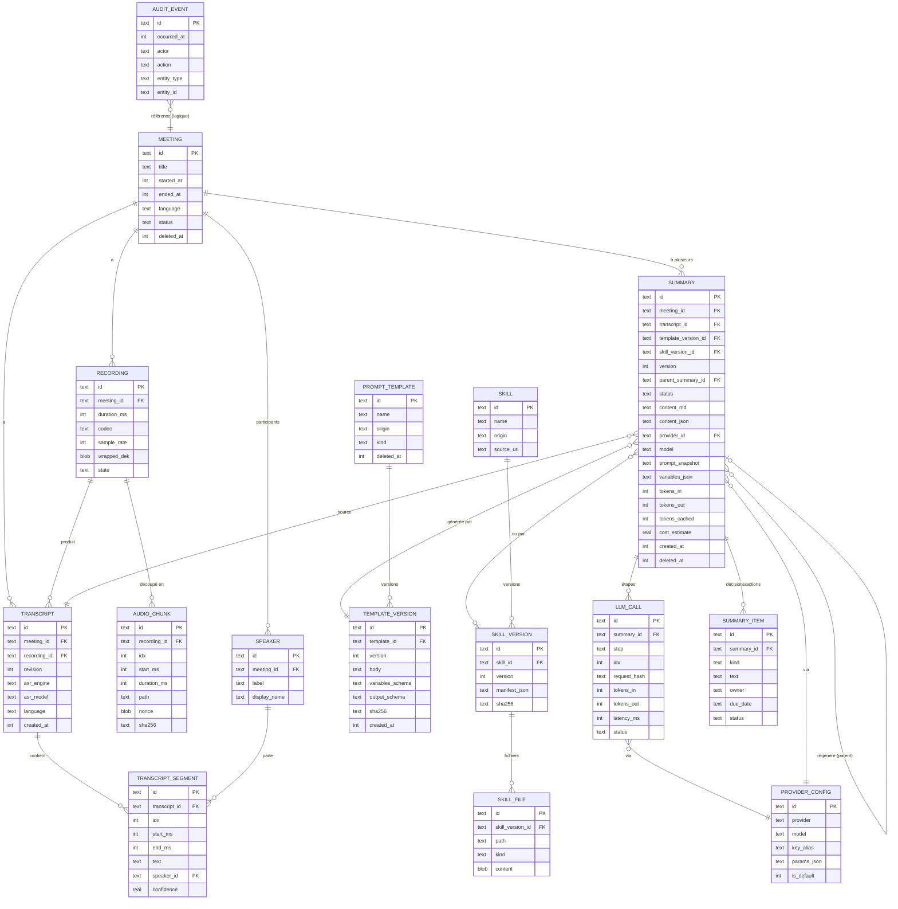

# 04 - Architecture et technologies (étude de bureau)

Date : 2026-10-27. Aucune ligne de code applicatif : schémas et pseudo-SQL uniquement.
Convention : « non vérifié » = information issue de ma connaissance générale ou d'une source secondaire non recoupée, à confirmer par un prototype ou la doc officielle avant décision.

Limite de méthode : les recherches ont renvoyé des synthèses de pages (pas toujours la page elle-même). Les pages officielles clés (Android Developers, drift, agentskills.io) sont citées, mais je n'ai pas relu chaque page en entier.

---

## 0. Synthèse décisionnelle

| Sujet | Recommandation |
|---|---|
| Stack | **Flutter** (Dart) comme socle unique Android + iOS, avec **un petit module natif Kotlin** (service de premier plan micro) et, côté iOS, une session audio native. Repli si l'équipe est surtout Kotlin : **Kotlin natif + KMP (logique partagée) avec UI SwiftUI** côté iOS. |
| ASR | `sherpa_onnx` (package Flutter officiel du projet k2-fsa), modèle Whisper (multilingue, français) ou Parakeet selon bench réel. Sur iOS, évaluer WhisperKit / FluidAudio en comparaison. |
| Base | SQLite chiffré : **drift + SQLite3MultipleCiphers** (nouvelle voie officielle drift) ou drift + SQLCipher en version héritée ; clé aléatoire 256 bits enveloppée par Keystore / Keychain. |
| Audio | Fichiers découpés en blocs de 1 à 5 min, chiffrés AES-256-GCM avec une clé par enregistrement (chiffrement enveloppe). |
| Historique | **Journal d'audit append-only (table `audit_event`) + versions immuables pour les contenus (résumés, gabarits) + suppression logique**. Pas d'event sourcing complet. |
| Résumés | Gabarits versionnés avec variables, « skills » au format SKILL.md importables (sans exécution de scripts), sorties structurées JSON Schema, map-reduce en repli. |

Les 3 risques techniques majeurs sont rappelés en section 9.

---

## 1. Comparatif des technologies

### 1.1 Faits vérifiés sur sherpa-onnx et l'ASR local

- sherpa-onnx (k2-fsa) couvre Android, iOS, 12 langages dont Kotlin, Java, Swift, Dart/Flutter, JavaScript, Rust, Go ; dépôt actif en 2026 ([dépôt k2-fsa/sherpa-onnx](https://github.com/k2-fsa/sherpa-onnx), [changelog](https://github.com/k2-fsa/sherpa-onnx/blob/master/CHANGELOG.md)).
- Flutter : package `sherpa_onnx` sur pub.dev, versions 1.13.x au changelog ([pub.dev](https://pub.dev/packages/sherpa_onnx), [changelog](https://pub.dev/packages/sherpa_onnx/changelog)). Les artefacts Android sont publiés en AAR ; la page des releases montrait une 2.0.1 fin octobre 2026 ([releases](https://github.com/k2-fsa/sherpa-onnx/releases)).
- Modèles : Whisper (avec timestamps ajoutés), NeMo Parakeet pris en charge depuis 1.10.28, chemins Parakeet TDT/CTC, VAD pour segmenter les longs enregistrements ([changelog](https://github.com/k2-fsa/sherpa-onnx/blob/master/CHANGELOG.md)).
- React Native : le changelog mentionne un wrapper RN ; l'écosystème comprend des wrappers communautaires. `react-native-sherpa-onnx` (XDcobra) est un TurboModule (Nouvelle Architecture) avec STT offline/streaming, Whisper, VAD ; le XCFramework iOS est téléchargé au `pod install` ; l'ancien `react-native-sherpa-onnx-stt` est déprécié ; `@siteed/sherpa-onnx.rn` est « en développement » ([XDcobra](https://github.com/XDcobra/react-native-sherpa-onnx), [stt déprécié](https://github.com/XDcobra/react-native-sherpa-onnx-stt), [npm @siteed](https://www.npmjs.com/package/@siteed/sherpa-onnx.rn?activeTab=dependents)). Ce sont des projets **non officiels** : risque de maintenance.
- whisper.cpp côté RN : `whisper.rn` 0.5.2, VAD Silero, transcription temps réel par tranches, Core ML sur iOS, gros modèles iOS nécessitant l'entitlement « Extended Virtual Addressing », support de Parakeet annoncé ; libération explicite des contextes ([npm whisper.rn](https://www.npmjs.com/package/whisper.rn), [AGENTS.md](https://github.com/mybigday/whisper.rn/blob/main/AGENTS.md)). Pas de support documenté de transcription en arrière-plan (à faire soi-même).
- iOS natif : WhisperKit (Argmax), v1.0.0 en mai 2026, v1.1.0 (août 2026) avec chargement incrémental à mémoire bornée pour les fichiers longs (réduction de pic mémoire annoncée de plus de 70 % sur 3 h) ; iOS 17+ ; Parakeet n'est pas dans WhisperKit mais dans FluidAudio (Core ML) ([synthèse forasoft](https://www.forasoft.com/blog/article/speech-recognition-with-neural-networks-on-ios-1621), [synthèse hapi](https://speakhapi.com/blog/what-is-whisperkit)). Source secondaire : à recouper sur le dépôt Argmax.
- Non vérifié : débit réel (facteur temps réel) de sherpa-onnx + Whisper/Parakeet sur un Android milieu de gamme pour 1-2 h d'audio, consommation mémoire, chauffe. À mesurer par prototype (voir risques). Non vérifié aussi : couverture du français et taille des variantes Parakeet v3 / « Nemotron ».

### 1.2 Faits vérifiés sur l'enregistrement long

- Android 14+ : un service de premier plan de type `microphone` exige `android:foregroundServiceType="microphone"`, la permission `FOREGROUND_SERVICE_MICROPHONE` et `RECORD_AUDIO` accordée ; sinon `SecurityException` à `startForeground()` ([types de services](https://developer.android.com/develop/background-work/services/fgs/service-types), [types obligatoires](https://developer.android.com/about/versions/14/changes/fgs-types-required)).
- `RECORD_AUDIO` est soumise aux restrictions « while-in-use » : on **ne peut pas démarrer** un service micro depuis l'arrière-plan ni depuis `BOOT_COMPLETED` (exceptions limitées) ; il faut démarrer pendant que l'UI d'enregistrement est visible ([restrictions de démarrage](https://developer.android.com/develop/background-work/services/fgs/restrictions-bg-start)).
- Une fois démarré au premier plan, le service continue écran éteint / app en arrière-plan avec notification persistante. Le délai de 3 minutes concerne le type `shortService`, pas `microphone` (pas de limite mentionnée dans la doc consultée ; vérification du comportement sur Android 15/16 : non vérifié).
- Play Console : déclaration des types de services de premier plan requise pour les apps ciblant Android 14+.
- Flutter : `flutter_foreground_task` (service typé + notification) + paquet `record` (capture) ; exemple de manifeste avec `microphone` ; à éviter : `autoRunOnBoot` pour l'enregistrement ([pub.dev flutter_foreground_task](https://pub.dev/packages/flutter_foreground_task), [issue #291](https://github.com/Dev-hwang/flutter_foreground_task/issues/291)). Un guide pratique recommande d'enregistrer par segments pour survivre à un kill du service.
- iOS : mode d'arrière-plan « audio » (`UIBackgroundModes: audio`) + `AVAudioSession` en catégorie `playAndRecord`, gestion des interruptions (appel entrant). **Non vérifié** (page Apple non consultée). Point critique non vérifié : le CPU lourd en arrière-plan sur iOS est limité en dehors de la session audio active ; `BGProcessingTask` existe mais sans garantie de déclenchement.

### 1.3 Tableau comparatif

Notation indicative (++ = très bon, + = bon, 0 = moyen, - = faible). Les notes reflètent mon analyse des faits ci-dessus ; les estimations d'effort sont des ordres de grandeur non sourcés.

| Critère | Flutter | React Native (Expo dev client / bare, Nouvelle Architecture) | Kotlin natif (Compose) | KMP + Compose Multiplatform |
|---|---|---|---|---|
| ASR sherpa-onnx | ++ paquet Dart officiel du projet | 0 wrappers communautaires (TurboModule XDcobra), ou whisper.rn mûr pour whisper.cpp | ++ API Kotlin/Java officielle + AAR | ++ Android (AAR) ; iOS via API Swift/C, `expect/actual` à écrire |
| Alternative whisper.cpp | 0 binding tiers (non vérifié), FFI possible | + whisper.rn (0.5.2) | + JNI/CMake direct | 0 |
| Enregistrement long arrière-plan | + plugin + petit module natif | + (module natif requis, non vérifié pour les libs Expo) | ++ contrôle total du service | ++ Android natif ; iOS natif à part |
| SQLite chiffré | + drift + SQLite3MultipleCiphers / SQLCipher ; `sqflite_sqlcipher` existe | + op-sqlite avec SQLCipher intégré ; un seul mainteneur (bus factor 1) | ++ Room + `sqlcipher-android` (SupportOpenHelperFactory) | 0 SQLCipher sur iOS fragile : liaison manuelle, échec silencieux si le linker résout vers `libsqlite3` système |
| Stockage de clés | + `flutter_secure_storage` (non vérifié sur versions 2026) ; Keystore natif possible | + expo-secure-store / react-native-keychain (non vérifié) | ++ Keystore direct, StrongBox | ++ Android, Keychain via Swift |
| Streaming HTTP (SSE) | + `dio`/`http` en flux | 0 dépend de la version de `fetch` (non vérifié) | ++ OkHttp/Ktor | ++ Ktor |
| Performance UI / ASR | + ASR en isolate/FFI, UI fluide | + ASR en natif, JS léger | ++ | ++ |
| iOS | ++ même code | ++ même code | - second app à écrire | + logique partagée, UI iOS à faire (Compose MP iOS stable depuis 1.8.0, mai 2025) |
| Effort d'équipe | faible (1 base) | faible-moyen | moyen Android, **élevé** si iOS ensuite | moyen-élevé |
| Maturité pour ce profil | bonne | correcte (écosystème ASR moins sûr) | excellente Android | bonne (KMP stable, adoption en hausse) |

Sources complémentaires : [op-sqlite SQLCipher](https://op-engineering.github.io/op-sqlite/docs/installation/), [PR op-sqlite sqlcipher](https://github.com/OP-Engineering/op-sqlite/pull/460), [comparatif SQLite RN 2026](https://dev.to/eira-wexford/best-sqlite-solutions-for-react-native-app-development-in-2026-3b5l), [drift chiffrement](https://drift.simonbinder.eu/platforms/encryption/), [KMP Room chiffré](https://github.com/Desquared/kmp-encrypted-room-database), [fil Zetetic](https://discuss.zetetic.net/t/sqlcipher-encryption-not-applied-to-room-database-for-ios/6875), [Compose Multiplatform iOS stable](https://daily.dev/posts/compose-multiplatform-1-8-0-released-compose-multiplatform-for-ios-is-stable-and-production-ready-x2mymxwf4) (source secondaire).

### 1.4 Conclusion du comparatif

1. **Flutter** : meilleur compromis « Android obligatoire + iOS si faisable » avec la **seule** option où le binding de l'ASR (sherpa-onnx) est maintenu par le projet lui-même et où le chiffrement SQLite est correctement documenté (drift). L'enregistrement long et le service Android passent par du natif léger (plugin + éventuellement un service Kotlin écrit à la main pour maîtriser les arrêts et les segments).
2. **Kotlin natif** est le choix le plus sûr si **seul Android compte réellement** : meilleur contrôle de l'audio, du service, de la mémoire de l'ASR. Son défaut : l'iOS devient un second projet ou un chantier KMP avec le point dur SQLCipher iOS (documenté comme fragile). À préférer si l'équipe est déjà Kotlin.
3. **React Native** : viable (whisper.rn, op-sqlite + SQLCipher), mais l'ASR sherpa-onnx dépend de wrappers communautaires ; pas de gain par rapport à Flutter sauf si l'équipe est TypeScript. Non vérifié : compatibilité de ces modules natifs avec Expo (probablement dev client/prebuild uniquement, pas Expo Go : inférence).
4. **KMP/Compose Multiplatform** : pertinent comme **trajectoire** (logique métier partagée, UI native Compose Android + SwiftUI iOS) mais coûteux sur le chiffrement iOS.

Décision à valider avec l'équipe : compétences Dart vs Kotlin vs TypeScript (non connues ici).

---

## 2. Stockage local chiffré

### 2.1 Base de données

- **SQLCipher** reste la référence (AES-256). Pour Flutter/drift, la doc actuelle (drift 2.32+, sqlite3 3.x) recommande **SQLite3MultipleCiphers** via `hooks: user_defines: sqlite3: source: sqlite3mc` ; clé posée par `PRAGMA key` dans le `setup` de `NativeDatabase` avant tout usage ; ouverture d'anciennes bases SQLCipher possible avec `PRAGMA cipher='sqlcipher'` et `PRAGMA legacy=4`. Pour d'anciennes versions : `sqlcipher_flutter_libs` à la place de `sqlite3_flutter_libs`, jamais les deux ([doc drift](https://drift.simonbinder.eu/platforms/encryption/), [issue #3702](https://github.com/simolus3/drift/issues/3702)).
- Piège commun : « file is not a database (code 26) » = clé ou liaison incorrecte ; sur iOS ne pas lier SQLite système et SQLCipher ensemble.
- Test de contrôle systématique : vérifier que le fichier ne commence **pas** par `SQLite format 3`, et que `PRAGMA cipher_version` renvoie une valeur (null = chiffrement non actif) ([discussion KMP](https://discuss.zetetic.net/t/sqlcipher-encryption-not-applied-to-room-database-for-ios/6875)).
- Choix d'un format : SQLCipher « standard » (interopérable, outillage de support) vs sqlite3mc (défaut ChaCha20, possibilité de compat SQLCipher). Recommandation : fixer explicitement le mode de compatibilité SQLCipher 4 pour garder la possibilité d'ouvrir la base avec les outils SQLCipher.
- FTS5 pour la recherche plein texte dans les transcriptions : compatibilité avec le chiffrement à confirmer. Non vérifié.

### 2.2 Clés : dérivation et stockage

Schéma en trois niveaux (chiffrement enveloppe) :

```
Clé maître (MK) de la base : 32 octets aléatoires (CSPRNG), générés au premier lancement
   |-- stockée enveloppée (AES-GCM) par une clé Keystore non exportable (Android, StrongBox si dispo)
   |   ou comme élément Keychain (iOS) : kSecAttrAccessibleAfterFirstUnlockThisDeviceOnly
   |-- (optionnel) 2e enveloppe sous une KEK dérivée d'une phrase de passe utilisateur (Argon2id)
   v
PRAGMA key = MK  (SQLCipher)

Clé de données audio (DEK) par enregistrement : 32 octets aléatoires
   |-- stockée dans la table `recording.wrapped_dek`, enveloppée par MK (ou une clé dédiée dérivée par HKDF)
```

Points de conception :
- **Accessibilité en arrière-plan** : l'enregistrement tourne écran verrouillé. Une clé Keystore avec `setUserAuthenticationRequired(true)` ou un item Keychain `WhenUnlocked` **bloquerait** le service. Il faut donc que la clé servant à chiffrer les blocs audio soit utilisable sans authentification récente (`AfterFirstUnlock` sur iOS ; clé Keystore sans exigence d'auth par usage), et que la protection biométrique/PIN soit appliquée à l'**ouverture de l'UI** (verrou d'application). Non vérifié sur Android 15/16 : à tester.
- **Suppression cryptographique** : supprimer `wrapped_dek` rend l'audio irrécupérable (crypto-erase), utile pour le droit à l'effacement et l'audit.
- **Secrets API** : les clés OpenAI/Anthropic de l'utilisateur ne vont **jamais** dans la base de données ; elles vivent dans Keystore/Keychain (ou stockage sécurisé du framework). La table `provider_config` ne contient qu'une référence (alias).
- **Rotation** : `PRAGMA rekey` pour changer MK ; rotation des DEK possible fichier par fichier. Journaliser l'événement `key_rotate` dans l'audit.

### 2.3 Chiffrement des fichiers audio

- Capturer en PCM 16 kHz mono (nécessaire à l'ASR : 16 000 x 2 octets x 7 200 s = environ 230 Mo par heure doublée, soit 230 Mo pour 2 h) et **encoder en Opus/AAC** pour le stockage long terme (Opus 24 kbit/s = environ 22 Mo pour 2 h). Débits de ma propre estimation arithmétique.
- Écriture par **blocs de 1 à 5 min** (chunks) chiffrés au fil de l'eau en AES-256-GCM (nonce unique par bloc, authentification du numéro de bloc en AAD). Intérêts : une panne ne perd qu'un bloc, l'ASR peut traiter les blocs déjà finis, et la lecture se fait par bloc (seek). Bibliothèque de chiffrement en flux type Tink Streaming AEAD possible : non vérifié.
- Le fichier PCM temporaire servant à l'ASR doit rester dans le stockage privé de l'app et être supprimé/écrasé après transcription (ou déchiffré en mémoire par bloc).
- Android : stockage privé interne (`filesDir`), jamais dans le stockage partagé. iOS : répertoire Application Support + attribut de protection de fichier (`.completeUntilFirstUserAuthentication`, qui permet l'écriture écran verrouillé après le premier déverrouillage ; non vérifié).

### 2.4 Sauvegardes

- Android : les clés Keystore **ne sont pas** sauvegardées mais les fichiers chiffrés le sont : après restauration le chiffrement échoue (« file is not a database »). Mesure : `android:allowBackup="false"` **et** `android:dataExtractionRules` excluant tous les domaines (nécessaire sur Android 12+ pour bloquer aussi le transfert appareil à appareil) + `fullBackupContent` pour les anciennes versions ([doc Auto Backup](https://developer.android.com/identity/data/autobackup), [retours terrain](https://github.com/swiftsaneai/sanenotes/issues/442)).
- Prévoir un **diagnostic de démarrage** : si une base existe mais que la clé est absente, ne pas écraser silencieusement ; mettre la base de côté (avec ses fichiers -wal/-shm) et proposer la restauration depuis un export utilisateur.
- iOS : exclure les fichiers de la sauvegarde via `isExcludedFromBackup` (`NSURLIsExcludedFromBackupKey`) et utiliser des items Keychain `...ThisDeviceOnly` (non migrés). Non vérifié (docs Apple non consultées).
- **Sauvegarde voulue par l'utilisateur** : export d'une archive chiffrée (clé dérivée d'une phrase de passe par Argon2id, sel + paramètres dans l'en-tête) vers le stockage choisi. C'est la seule voie de portabilité entre appareils si l'on désactive les sauvegardes système.

---

## 3. Historique des opérations CRUD

### 3.1 Options comparées

| Critère | Journal d'audit (event log) | Event sourcing complet | Suppression logique + versions |
|---|---|---|---|
| Principe | Table append-only qui trace chaque action ; l'état courant reste dans les tables normales | Les événements sont la source de vérité, l'état est une projection | Colonnes `deleted_at`, tables `*_version` |
| Complexité | Faible | Élevée (projections, migrations d'événements, rejeu) | Faible-moyenne |
| Reconstitution d'un état passé | Partielle (diff) | Totale | Totale pour les entités versionnées |
| Coût stockage mobile | Faible | Moyen-élevé | Moyen |
| Adapté à : audit, preuve | Oui | Oui (excessif) | Non seul (pas de trace de qui/quand/quoi) |
| Risque | Oubli d'écriture si hors transaction | Sur-ingénierie pour une app locale mono-utilisateur | Perte d'information sur les changements de champs |

### 3.2 Recommandation

**Hybride sobre : journal d'audit + versions immuables pour le contenu éditable + suppression logique avec corbeille.**

1. **`audit_event` append-only** écrit **dans la même transaction SQLite** que la mutation (garantit l'atomicité : pas de mutation sans événement). Des triggers SQLite peuvent servir de filet de sécurité (ils ne connaissent pas l'acteur : l'acteur et la raison viennent de la couche dépôt).
2. **Versions immuables** pour ce qui compte : `summary` (une régénération crée une nouvelle ligne ou une version, jamais une modification), `prompt_template_version`, `skill_version`, `transcript_revision` (corrections manuelles).
3. **Suppression logique** (`deleted_at`) avec délai de corbeille, puis **purge dure** (suppression des lignes + crypto-erase des DEK audio) ; l'événement d'audit de purge subsiste **sans contenu**.
4. **Pas de contenu sensible dans l'audit** : stocker des identifiants, des noms de champs modifiés, des empreintes (hash) et des références de version, pas le texte des transcriptions ni des résumés (sinon la purge ne purge rien).
5. **Intégrité** (option) : chaîne de hachage (`prev_hash`, `hash`) pour détecter une altération ; utile pour la valeur d'audit mais pas une preuve juridique en soi (la base est locale, l'utilisateur en détient la clé).

L'event sourcing complet est écarté : une app locale mono-utilisateur n'a pas besoin de rejouer l'historique, et les projections alourdissent les migrations. Aucune source externe n'a été consultée pour ce comparatif : jugement d'architecte (non vérifié par la littérature).

### 3.3 Schéma `audit_event`

```sql
audit_event(
  id            TEXT PRIMARY KEY,      -- ULID/UUIDv7, ordre temporel
  occurred_at   INTEGER NOT NULL,      -- epoch ms UTC
  actor         TEXT NOT NULL,         -- 'user' | 'system' | 'import' | 'migration'
  action        TEXT NOT NULL,         -- create | update | delete | restore | purge | regenerate | import | export | key_rotate | send_to_llm
  entity_type   TEXT NOT NULL,         -- meeting | recording | transcript | summary | template | skill | provider_config | ...
  entity_id     TEXT NOT NULL,
  entity_version INTEGER,              -- version créée/touchée si pertinent
  changed_fields TEXT,                 -- JSON : liste des champs, sans valeurs sensibles
  content_hash  TEXT,                  -- SHA-256 du contenu concerné (pas le contenu)
  meta          TEXT,                  -- JSON : modèle LLM, tokens, appareil, version de l'app
  prev_hash     TEXT, hash TEXT        -- chaîne optionnelle
);
CREATE INDEX audit_entity ON audit_event(entity_type, entity_id, occurred_at);
-- Triggers: refuser UPDATE/DELETE sur audit_event (append-only), sauf purge de rétention explicite.
```

---

## 4. Modèle de données

### 4.1 Diagramme



### 4.2 Tables principales (pseudo-SQL)

```sql
meeting(id PK, title, started_at, ended_at, language, status, notes, deleted_at, created_at, updated_at)

recording(id PK, meeting_id FK, duration_ms, codec, sample_rate, channels,
          wrapped_dek BLOB,            -- DEK audio enveloppée
          state,                       -- recording | finalizing | ready | failed | purged
          created_at, deleted_at)

audio_chunk(id PK, recording_id FK, idx, start_ms, duration_ms,
            path, nonce BLOB, sha256, UNIQUE(recording_id, idx))

transcript(id PK, meeting_id FK, recording_id FK, revision, asr_engine, asr_model,
           asr_params_json, language, status, created_at)
transcript_segment(id PK, transcript_id FK, idx, start_ms, end_ms, text,
                   speaker_id NULL, confidence NULL)       -- FTS5 sur text (non vérifié avec chiffrement)
speaker(id PK, meeting_id FK, label, display_name)         -- diarisation optionnelle

summary(id PK, meeting_id FK, transcript_id FK, transcript_revision,
        template_version_id FK NULL, skill_version_id FK NULL,
        version, parent_summary_id NULL,
        status,                        -- queued | running | done | failed | partial
        content_md, content_json,      -- Markdown rendu + JSON structuré
        provider, model, params_json,  -- température, max_tokens...
        prompt_snapshot,               -- prompt exact envoyé (rendu, variables résolues)
        variables_json,
        tokens_in, tokens_out, tokens_cached, cost_estimate, currency,
        started_at, finished_at, error, deleted_at)

summary_item(id PK, summary_id FK, kind /* decision|action|risk|question */,
             text, owner, due_date, status, source_start_ms, source_end_ms)

llm_call(id PK, summary_id FK, step /* map|reduce|single|repair */, idx,
         request_hash, tokens_in, tokens_out, latency_ms, status, error)

prompt_template(id PK, name, origin /* builtin | user | imported */, kind, deleted_at)
template_version(id PK, template_id FK, version, body, variables_schema_json,
                 output_schema_json NULL, sha256, created_at)   -- immuable

skill(id PK, name, origin, source_uri, deleted_at)
skill_version(id PK, skill_id FK, version, manifest_json, sha256, created_at)
skill_file(id PK, skill_version_id FK, path, kind /* skill_md | reference | asset */, content BLOB)

provider_config(id PK, provider /* openai|anthropic */, model, key_alias, params_json, is_default)
   -- AUCUN secret : key_alias renvoie à Keystore/Keychain
```

Remarques :
- **Gabarits intégrés** (`origin=builtin`) : livrés avec l'app, versionnés par l'app ; l'utilisateur les duplique pour modifier (pas de modification de l'original).
- **Snapshot de prompt** : le prompt rendu est stocké dans `summary.prompt_snapshot` pour reproductibilité et audit, même si le gabarit change ensuite. Attention : il contient la transcription entière (volumineux) ; stocker plutôt le gabarit rendu **sans** la transcription + `transcript_revision` + hash, la transcription étant reconstituable. Arbitrage à trancher.
- **Coût** : `tokens_*` viennent de la réponse de l'API ; `cost_estimate` dépend d'une table de prix locale (les tarifs changent : non vérifié, prévoir une table de prix éditable avec date).
- `SUMMARY_ITEM` facilite le suivi des actions (filtrage, export) sans réparser le JSON.

---

## 5. Mécanisme de résumé personnalisé

### 5.1 Formats prédéfinis

Livrés comme `prompt_template` `origin=builtin` : compte rendu, décisions + actions, synthèse exécutive, points clés, e-mail de suivi. Chacun porte : un corps (instructions), un `variables_schema`, et éventuellement un `output_schema` (JSON) ; les formats « décisions/actions » utilisent la sortie structurée, les autres produisent du Markdown.

### 5.2 Gabarits avec variables

- Syntaxe simple et sûre : `{{variable}}` avec un moteur **sans exécution de code** (type Mustache/Liquid restreint). Pas d'évaluation d'expressions arbitraires.
- Variables système : `{{transcript}}`, `{{meeting.title}}`, `{{meeting.date}}`, `{{participants}}`, `{{language}}`, `{{duration}}` ; variables utilisateur déclarées dans `variables_schema` (nom, type, défaut, obligatoire, libellé du champ de formulaire).
- Validation avant envoi : variables manquantes, estimation des tokens, coût estimé, avertissement de confidentialité (le transcript part chez le fournisseur choisi).
- **Injection de prompt** : le texte de la transcription est une donnée non fiable ; l'encadrer par des délimiteurs et une consigne explicite de le traiter comme données. Le résumé ne doit déclencher aucune action automatique.

### 5.3 Skills (SKILL.md) importables

Format ouvert « Agent Skills » publié par Anthropic (introduit en octobre 2025, ouvert en décembre 2025) : un dossier contenant au minimum `SKILL.md` avec en-tête YAML (`name` obligatoire, 64 caractères max, minuscules/chiffres/tirets ; `description` obligatoire, moins de 1 024 caractères), puis Markdown ; dossiers optionnels `scripts/`, `references/`, `assets/` ; champs optionnels `license`, `compatibility`, `metadata`, `allowed-tools` ; chargement progressif (nom/description toujours, corps à l'activation, références à la demande) ([spécification](https://agentskills.io/specification), [synthèses](https://www.webfuse.com/agent-skills-cheat-sheet), [mdskills](https://www.mdskills.ai/specs/skill-md)). Les sources secondaires divergent sur la rigueur de `allowed-tools` : à confirmer sur la spécification.

Application à l'app (propositions) :
- **Import** : sélecteur de fichier (`.md` seul, ou `.zip` d'un dossier skill). Validation stricte : taille maximale, nombre de fichiers, extensions autorisées, noms de chemin normalisés (anti « zip slip »), YAML parsé en mode sûr.
- **Pas d'exécution de `scripts/`** : une app mobile n'exécute pas de code importé ; ces fichiers sont ignorés ou refusés, et l'utilisateur en est informé. C'est un écart volontaire avec l'usage « agent ».
- **Variables** : la spécification ne définit pas de variables de gabarit. Convention locale proposée : bloc `metadata` (ex. `metadata.variables`) ou fichier annexe `variables.yaml`. Je n'ai pas vérifié que `metadata` accepte des structures imbriquées : à tester avec un validateur.
- **Exécution** : le corps de `SKILL.md` est injecté comme instruction système ; les `references/` ne sont ajoutées que si le skill les référence ou si l'utilisateur les coche (budget de tokens).
- **Versionnage** : chaque import crée une `skill_version` (sha256 du contenu) ; réimporter un contenu identique ne crée pas de version.
- **Provenance** : `source_uri`, hash, date d'import dans l'audit ; avertissement à l'import d'un skill tiers (instructions potentiellement malveillantes : exfiltration par prompt, etc.).

### 5.4 Longues transcriptions : map-reduce

Ordre de grandeur (estimation personnelle) : 1 h de réunion parlée = environ 8 000 à 10 000 mots, soit environ 12 000 à 20 000 tokens en français selon le tokenizer ; 2 h = 25 000 à 40 000 tokens. Les fenêtres de contexte actuelles des modèles OpenAI/Anthropic sont probablement suffisantes pour un passage unique dans la plupart des cas, mais **non vérifié** : lire la fiche du modèle choisi au moment de l'implémentation.

Stratégie :
1. **Passage unique par défaut** si `tokens_estimés + marge_sortie <= 70 % de la fenêtre du modèle` (table des fenêtres éditable ; estimateur prudent).
2. Sinon **map-reduce** : découpage par segments horodatés en blocs (par ex. 10 à 20 min) avec chevauchement de quelques phrases ; **map** : extraction structurée par bloc (points clés, décisions, actions, citations, avec les horodatages) ; **reduce** : fusion et dédoublonnage vers le format cible. Les étapes sont tracées dans `llm_call`.
3. **Reprise** : chaque appel est idempotent (`request_hash`) ; en cas d'échec réseau on reprend à l'étape en erreur ; statut `partial` possible.
4. **Coût et latence** : afficher avant lancement l'estimation (tokens x tarif) ; le map-reduce multiplie les appels. Les mécanismes de cache de prompt des fournisseurs peuvent réduire le coût de préfixes répétés : non vérifié (à lire dans la doc de chaque API).
5. **Appel direct appareil vers fournisseur** avec la clé de l'utilisateur ; pas de proxy applicatif (pas de serveur, pas de fuite de transcription vers un tiers de plus).

### 5.5 Sortie structurée (décisions, actions)

- **OpenAI** : dans l'API Responses, le schéma se place sous `text.format` (`type: "json_schema"`, `name`, `strict: true`, `schema`) ; en mode strict, chaque objet porte `additionalProperties: false` et tous les champs sont listés dans `required` ([guide Structured Outputs](https://platform.openai.com/docs/guides/structured-outputs), [migration vers Responses](https://platform.openai.com/docs/guides/migrate-to-responses)).
- **Anthropic** : sorties structurées passées du bêta (en-tête `structured-outputs-2025-11-13`, paramètre `output_format`) à une forme stable `output_config.format` avec `type: "json_schema"` ; aussi `strict: true` sur les outils ([synthèse](https://thomas-wiegold.com/blog/claude-api-structured-output/), [doc Agent SDK](https://platform.claude.com/docs/en/agent-sdk/structured-outputs), [Bedrock](https://aws.amazon.com/blogs/machine-learning/structured-outputs-for-anthropic-claude-models-on-amazon-bedrock/)). Source secondaire en partie : relire la doc officielle de l'API Messages.
- Les deux garantissent la **forme**, pas la **vérité** : valider côté app (schéma + règles métier), stocker `content_json`, et permettre la correction manuelle (qui crée une nouvelle version).
- Abstraction `LlmProvider` interne : `complete(prompt, schema?) -> stream<token>` ; un adaptateur par fournisseur ; le sous-ensemble de JSON Schema commun aux deux doit être documenté (non vérifié : les sous-ensembles supportés diffèrent).
- **Streaming** : SSE pour l'affichage progressif (OpenAI et Anthropic en proposent) ; en mode structuré, n'afficher le JSON qu'une fois complet, ou parser en incrémental.

### 5.6 Export

| Format | Approche | Remarque |
|---|---|---|
| Markdown | Direct (`content_md`) | Format pivot, fichier `.md` + partage |
| PDF | Rendu natif : paquet `pdf`/`printing` (Flutter), `PdfDocument` (Android), `UIGraphicsPDFRenderer` (iOS) | Polices embarquées pour le français (accents) ; non vérifié sur les paquets cités |
| DOCX | Générer l'OOXML minimal (zip de XML) à partir d'un Markdown restreint | Le plus coûteux ; à reporter en version 2. Non vérifié : maturité des bibliothèques mobiles |
| E-mail | Intent mail avec corps pré-rempli (format « e-mail à envoyer ») | Aucune donnée ne transite par un serveur de l'app |
| Partage | Feuille de partage système (`share_plus` / `ACTION_SEND` / `UIActivityViewController`) | Les fichiers exportés sortent du chiffrement : avertir l'utilisateur, nettoyer le cache d'export |

Chaque export est tracé dans `audit_event` (`action=export`, format, sans contenu).

---

## 6. Arborescence logique de l'application (indicatif)

```
presentation (UI)  ->  application (cas d'usage)  ->  domain (entités, règles)
                                  |
                  infrastructure: db (drift/SQLCipher), crypto (clés, AES-GCM),
                                  asr (sherpa-onnx), recorder (service micro),
                                  llm (OpenAI, Anthropic), export, audit
```

Règle : tout accès en écriture passe par un dépôt qui ouvre une transaction, effectue la mutation et insère l'`audit_event`.

Processus d'enregistrement : `RecordingService` (service de premier plan Android / session audio iOS) -> blocs chiffrés + VAD -> file d'attente d'ASR -> transcription incrémentale (segments) -> fin d'enregistrement : transcription consolidée -> résumé à la demande.

---

## 7. Plan de prototypage recommandé (avant engagement)

1. **Bench ASR** : sherpa-onnx (Whisper small/medium, Parakeet) sur 2 à 3 appareils Android réels (bas, moyen, haut de gamme) et un iPhone : facteur temps réel, pic mémoire, température, WER sur du français de réunion.
2. **Enregistrement 2 h écran verrouillé** : service micro Android 14/15/16, interruptions (appel, Bluetooth), kill par économie d'énergie constructeur ; iOS : session audio, interruption.
3. **Chiffrement** : base ouverte avec clé Keystore/Keychain, test de non-lisibilité, restauration après sauvegarde bloquée.
4. **Appels LLM** : streaming + sortie structurée sur les deux fournisseurs avec une transcription de 2 h réelle.

---

## 8. Hypothèses et points non vérifiés (liste)

- Compétences de l'équipe (Dart, Kotlin, TypeScript) : inconnues.
- Débit/mémoire de l'ASR sur appareils réels ; couverture du français des modèles Parakeet/Nemotron.
- Comportement de `microphone` FGS sur Android 15/16 ; limites de durée d'autres types de service pour un traitement ASR post-enregistrement (`dataSync` ou équivalent) : non vérifié.
- iOS : détails des modes d'arrière-plan, de `BGProcessingTask`, des classes de protection de fichiers et de l'exclusion de sauvegarde (docs Apple non lues).
- Compatibilité FTS5 avec SQLCipher/sqlite3mc ; Tink Streaming AEAD ; versions courantes de `flutter_secure_storage`, `record`.
- Fenêtres de contexte et tarifs actuels des modèles ; mécanismes de cache de prompt.
- Sous-ensembles JSON Schema supportés par chaque fournisseur.
- Compatibilité des modules natifs RN avec Expo ; support du streaming dans `fetch` React Native.
- Propriété `metadata` du format SKILL.md (structures imbriquées) ; rigueur de `allowed-tools`.
- Aspects juridiques (information des participants, RGPD, transfert vers un fournisseur américain) : hors périmètre technique, à traiter à part.

---

## 9. Trois principaux risques techniques

1. **ASR local sur 1-2 h d'audio** : débit, mémoire et chauffe sur Android milieu de gamme ; sur iOS, calcul lourd en arrière-plan limité. Mitigation : bench précoce, transcription incrémentale pendant l'enregistrement (avec VAD), modèle plus petit en repli, reprise après interruption.
2. **Enregistrement long fiable** : démarrage uniquement au premier plan (Android 14+), kills constructeurs, interruptions audio iOS. Mitigation : service typé, blocs de 1 à 5 min chiffrés au fil de l'eau, reprise de session, tests sur appareils réels.
3. **Chiffrement et clés** : clé Keystore/Keychain inaccessible ou perdue (restauration, réinstallation, auth requise bloquant le service), échec silencieux du chiffrement SQLCipher (surtout KMP/iOS, ou mauvais lien de bibliothèque). Mitigation : sauvegardes système désactivées, export chiffré utilisateur, tests automatisés « fichier illisible », diagnostic de démarrage.

---

## Sources

- sherpa-onnx : [GitHub](https://github.com/k2-fsa/sherpa-onnx), [CHANGELOG](https://github.com/k2-fsa/sherpa-onnx/blob/master/CHANGELOG.md), [releases](https://github.com/k2-fsa/sherpa-onnx/releases), [pub.dev](https://pub.dev/packages/sherpa_onnx)
- Wrappers RN : [XDcobra](https://github.com/XDcobra/react-native-sherpa-onnx), [@siteed](https://www.npmjs.com/package/@siteed/sherpa-onnx.rn?activeTab=dependents), [whisper.rn](https://www.npmjs.com/package/whisper.rn)
- iOS ASR : [WhisperKit / SpeechAnalyzer](https://www.forasoft.com/blog/article/speech-recognition-with-neural-networks-on-ios-1621), [WhisperKit](https://speakhapi.com/blog/what-is-whisperkit)
- Android : [types de services](https://developer.android.com/develop/background-work/services/fgs/service-types), [démarrage depuis l'arrière-plan](https://developer.android.com/develop/background-work/services/fgs/restrictions-bg-start), [types obligatoires Android 14](https://developer.android.com/about/versions/14/changes/fgs-types-required), [Auto Backup](https://developer.android.com/identity/data/autobackup)
- Flutter : [flutter_foreground_task](https://pub.dev/packages/flutter_foreground_task), [drift chiffrement](https://drift.simonbinder.eu/platforms/encryption/)
- RN SQLite : [op-sqlite](https://op-engineering.github.io/op-sqlite/docs/installation/), [PR #460](https://github.com/OP-Engineering/op-sqlite/pull/460)
- KMP : [Room chiffré KMP](https://github.com/Desquared/kmp-encrypted-room-database), [Zetetic](https://discuss.zetetic.net/t/sqlcipher-encryption-not-applied-to-room-database-for-ios/6875), [Compose Multiplatform 1.8](https://daily.dev/posts/compose-multiplatform-1-8-0-released-compose-multiplatform-for-ios-is-stable-and-production-ready-x2mymxwf4)
- Skills : [agentskills.io](https://agentskills.io/specification)
- Sorties structurées : [OpenAI](https://platform.openai.com/docs/guides/structured-outputs), [OpenAI migration Responses](https://platform.openai.com/docs/guides/migrate-to-responses), [Anthropic (Agent SDK)](https://platform.claude.com/docs/en/agent-sdk/structured-outputs)
