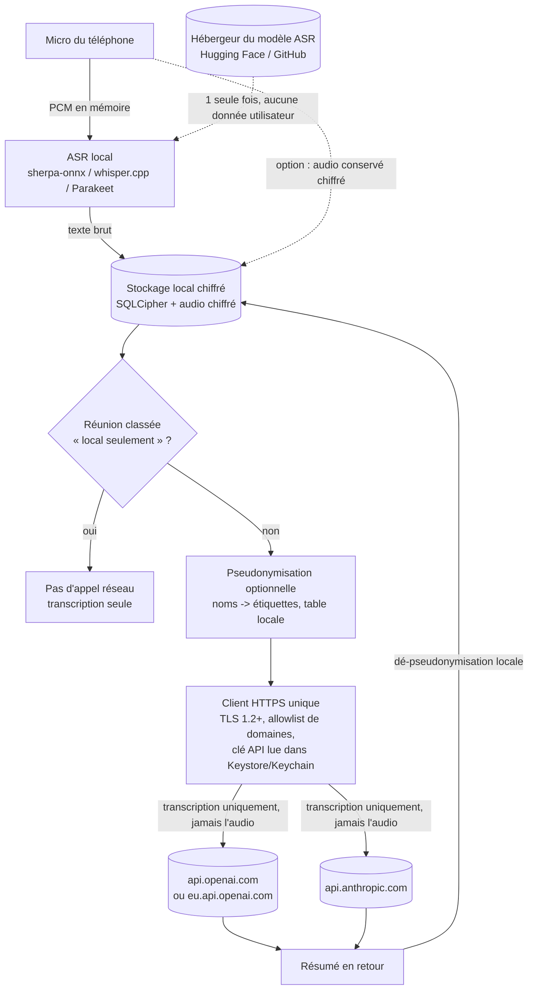

# 05 - Confidentialité, flux de données et conformité RGPD

Date de l'étude : 2026-10-27. Étude documentaire, sans code.

> Avertissement : ce document n'est pas un avis juridique. Il rassemble des sources publiques et des raisonnements d'ingénierie. Toute mise en production en entreprise doit être validée par le DPO / un juriste. Les points non confirmés par une source officielle consultée pendant cette étude sont marqués **non vérifié**.

Légende des sources : officielle = documentation éditeur / texte de loi / autorité ; secondaire = blog, cabinet, comparatif (à recouper).

---

## 1. Flux de données exact et connexions sortantes

### 1.1 Schéma du flux (Mermaid)

Étapes : (1) capture audio, (2) transcription 100 % sur l'appareil, (3) stockage local chiffré, (4) choix du mode (local seulement ou envoi), (5) pseudonymisation optionnelle, (6) un seul appel HTTPS vers le fournisseur choisi, (7) réception du résumé et ré-association locale des noms.

### 1.2 Liste exhaustive des connexions sortantes admissibles

| # | Destination | Quand | Données envoyées | Remarque |
|---|---|---|---|---|
| 1 | `api.openai.com` (ou `eu.api.openai.com` si résidence UE) | À chaque résumé OpenAI | Transcription + prompt + clé API | Voir section 3 |
| 2 | `api.anthropic.com` | À chaque résumé Anthropic | Idem | Pas de région UE sur l'API directe (section 3) |
| 3 | Hébergeur du modèle ASR | Une seule fois, au premier lancement | Aucune donnée utilisateur ; l'hébergeur voit l'IP et le user-agent | Voir 1.3 |

Tout le reste doit être **zéro** : pas de télémétrie, pas de rapport de crash, pas de vérification de mises à jour hors store, pas de CDN de polices, pas de WebView vers des tiers, pas de service de géolocalisation d'IP.

### 1.3 Téléchargement du modèle ASR : options

- **Hugging Face / GitHub releases** (hébergement habituel des modèles sherpa-onnx et whisper.cpp : **non vérifié** dans cette étude, à confirmer modèle par modèle). Le tiers reçoit l'adresse IP, l'horodatage et le fait que l'appareil télécharge ce modèle. Aucune donnée de réunion. Cela reste un tiers au sens strict de l'exigence « aucun tiers autre qu'OpenAI/Anthropic » : à signaler ou à éviter.
- **Embarquer le modèle dans l'APK/AAB** : zéro connexion tierce, mais taille du paquet (limites Play Store à vérifier : **non vérifié**).
- **Play Asset Delivery** (Android) ou **On-Demand Resources** (iOS) : le modèle est servi par le store (déjà tiers de fait pour l'installation). Aucun nouveau tiers, pas d'hébergeur additionnel. **Non vérifié** : limites de taille et comportement exact consultés ici.
- **Miroir interne de l'entreprise** (serveur HTTPS de la société, hash SHA-256 épinglé dans l'app) : le tiers disparaît mais l'entreprise devient destinataire de l'IP ; acceptable si c'est l'entreprise elle-même. À ajouter à l'allowlist.
- Dans tous les cas : vérifier l'intégrité du modèle (hash embarqué dans l'app) pour éviter qu'un modèle altéré soit chargé.

### 1.4 Comment garantir « aucun autre tiers »

**A. Dépendances et SDK**
- Interdire Firebase (Analytics, Crashlytics, Messaging, Remote Config), Sentry, AppCenter, Segment, Adjust, etc. Contrôler le manifeste **fusionné** (`merged manifest`) et l'arbre de dépendances, car des bibliothèques transitives peuvent embarquer un SDK Google ou un service de métriques.
- Flutter : la documentation officielle indique que l'**outil** `flutter` collecte des analytiques et des rapports de crash côté poste de développement, désactivables par `flutter --disable-analytics` ([doc Flutter](https://docs.flutter.dev/reference/crash-reporting)). Cela concerne le développeur, pas l'app. Le comportement réseau du framework dans l'app compilée n'est pas traité par cette page : **non vérifié** (à confirmer par capture réseau).
- React Native / Expo : l'outil Expo CLI envoie une télémétrie anonyme, désactivable par `EXPO_NO_TELEMETRY=1` ([doc Expo CLI](https://docs.expo.dev/more/expo-cli/)). Côté app, `expo-updates` vérifie par défaut les mises à jour au démarrage (`checkAutomatically` = `ON_LOAD`) ; il faut le mettre à `NEVER` ou désactiver la bibliothèque ([doc expo-updates](https://docs.expo.dev/versions/latest/sdk/updates/)). La doc ne précise pas si `updates.enabled=false` supprime toute requête réseau : **non vérifié**. Éviter EAS Update ; les mises à jour passent par le store.
- Google Play Services : à ne pas utiliser comme dépendance fonctionnelle (FCM, Play Integrity, ML Kit en mode téléchargement de modèles). Leur présence génère des connexions vers Google : **non vérifié** au détail près, à mesurer.
- Reconnaissance vocale : ne **jamais** utiliser le `SpeechRecognizer` système ou les API cloud de l'OS, qui peuvent envoyer l'audio à un tiers (comportement dépendant du fabricant : **non vérifié**). Seul le moteur embarqué est acceptable.
- Clavier, presse-papier, outils d'accessibilité et logs système du téléphone échappent au contrôle de l'app : à traiter par politique MDM (section 4).

**B. Configuration réseau Android**
- Le `network-security-config` permet de désactiver le trafic en clair et de scoper des règles par `<domain-config>` ; ce n'est **pas** une allowlist stricte : il règle la confiance TLS et le clair, il ne bloque pas un domaine ([doc Android](https://developer.android.com/privacy-and-security/security-config)). À partir d'Android 9 le clair est interdit par défaut.
- Astuce d'ingénierie (**non vérifié**, à tester) : une `base-config` sans aucun `trust-anchors` fait échouer la validation TLS de tout domaine non déclaré, et un `domain-config` pour `api.openai.com` et `api.anthropic.com` rétablit la confiance système uniquement pour eux. Cela ne couvre que les piles réseau qui utilisent le TrustManager de la plateforme (pas un moteur TLS embarqué).
- Allowlist applicative réelle : un **unique client HTTP** (par exemple OkHttp) construit avec une liste fermée d'hôtes, un `Dns` personnalisé qui refuse tout autre nom, et aucune autre bibliothèque réseau dans le projet. Côté iOS, équivalent via App Transport Security (`NSAppTransportSecurity`) et un `URLSession` unique : **non vérifié** en détail.
- Retirer la permission `INTERNET` du build « local seulement » si une variante de ce type est livrée : preuve forte à l'audit.

**C. Épinglage de certificats (certificate pinning)**
- Pour : empêche un CA frauduleux ou un proxy d'interception de lire les transcriptions.
- Contre : la doc Android impose un **pin de secours** sous peine de coupure en cas de rotation, et note qu'une date d'expiration de pins peut être exploitée par un attaquant ([doc Android](https://developer.android.com/privacy-and-security/security-config)). Les certificats d'OpenAI et d'Anthropic changent sans préavis (non vérifié) : épingler la clé d'une **CA intermédiaire** plutôt que la feuille, avec plusieurs pins et un mécanisme de mise à jour par le store.
- En entreprise : l'inspection TLS des pare-feu (proxys MITM) casse l'épinglage ; prévoir une politique (exemption documentée) plutôt qu'un contournement dans l'app.
- Compromis raisonnable : épingler les CA intermédiaires + allowlist de domaines + journal local des échecs TLS.

**D. Vérification indépendante**
- **Exodus Privacy** : analyse statique de l'APK qui compare des signatures de pisteurs ; ne prouve pas l'activité et n'analyse pas iOS ([FAQ Exodus](https://exodus-privacy.eu.org/en/page/faq/)). Utile comme garde-fou en CI, pas comme preuve.
- **PCAPdroid** (capture locale sans root) et **mitmproxy** (intercepteur) : mesure du trafic réel ; mitmproxy nécessite d'installer un CA utilisateur, que les apps ciblant Android 7+ ne font pas confiance par défaut, sauf `debug-overrides` en build de test (**non vérifié** ici, connaissance générale). Protocole proposé : build de test, installation propre, parcours complet (enregistrement, résumé, suppression, mise à jour), puis liste des SNI/IP contactés ; tout hôte hors allowlist = échec.
- **F-Droid / builds reproductibles** : permettent à un tiers de vérifier que l'APK diffusé correspond au code source. **Non vérifié** : les contraintes F-Droid (anti-features, dépendances propriétaires) n'ont pas été consultées ; intérêt surtout si l'entreprise veut une preuve d'absence de pisteurs. En distribution interne (MDM), un build reproductible maison + SBOM remplit un rôle voisin.
- **Formulaire « Sécurité des données » (Data safety) du Play Store** : doit refléter les envois vers OpenAI/Anthropic. La qualification exacte (« collecté », « partagé », exemption « traitement par le fournisseur de service ») n'a pas été vérifiée : **non vérifié**. Rédiger par prudence en déclarant l'envoi du texte transcrit et en précisant l'absence d'autres destinataires.

---

## 2. Chiffrement au repos et protections locales

| Mesure | Recommandation | Statut |
|---|---|---|
| Base de données | SQLCipher (AES-256) pour transcriptions, résumés, métadonnées | Pratique courante ; non vérifié ici |
| Fichiers audio | Chiffrement par fichier (AES-GCM) avec clé par enregistrement | Non vérifié |
| Gestion des clés | Clé maîtresse dans Android Keystore (matériel/StrongBox si dispo) ou Keychain iOS (Secure Enclave) ; clé non exportable | Non vérifié ici |
| Verrouillage applicatif | `BiometricPrompt` avec `CryptoObject` : la clé n'est déverrouillée qu'après authentification, délai de verrouillage court | Non vérifié ici |
| Clé API | Stockée chiffrée dans Keystore, jamais en dur ni dans les logs ; clé d'**entreprise** (voir section 4) | Règle globale |
| Sauvegarde | `android:allowBackup="false"` ; si besoin, `dataExtractionRules` avec exclusions pour `cloud-backup` **et** `device-transfer` (Android 12+), plus `fullBackupContent` pour Android 11 et moins. Sur Android 12+, certains fabricants gardent le transfert appareil à appareil malgré `allowBackup=false` ([doc Android](https://developer.android.com/identity/data/autobackup)) | Officielle |
| Capture d'écran | `FLAG_SECURE` sur les fenêtres sensibles (masque aussi l'aperçu dans les « apps récentes ») ; ne protège pas d'une photo de l'écran. La page officielle ciblée n'a pas pu être lue (erreur 404) | **Non vérifié** (officielle non consultée) |
| Suppression de l'audio après transcription | Option activée par défaut recommandée ; la CNIL recommande de supprimer l'enregistrement dès la finalité atteinte (source secondaire, section 4) | Secondaire |
| Effacement sécurisé | Sur mémoire flash, l'écrasement n'est pas fiable (wear-leveling) ; privilégier l'**effacement cryptographique** : détruire la clé Keystore rend les données illisibles, puis supprimer fichiers et base | Raisonnement standard ; non vérifié ici |
| Fuites annexes | Pas de transcription dans les notifications, logs, presse-papier, cache d'aperçu ni exports non chiffrés ; fichiers dans le répertoire interne de l'app | Bonne pratique |

Remarque : la clé API et les transcriptions déjà envoyées au fournisseur échappent à ces protections (elles sont chez lui pendant sa durée de rétention).

---

## 3. Côté fournisseurs d'API (OpenAI, Anthropic)

### 3.1 OpenAI

- Rétention par défaut : journaux de détection d'abus conservés jusqu'à 30 jours ; plus longtemps si la loi l'exige ou si nécessaire pour protéger les services ([Données et contrôles, officielle](https://developers.openai.com/api/docs/guides/your-data)).
- Entraînement : les données envoyées à l'API ne servent pas à entraîner les modèles sauf opt-in explicite (même page).
- Zéro rétention (ZDR) et « Modified Abuse Monitoring » (MAM) : sur approbation préalable d'OpenAI, pas en libre-service ; sous ZDR, `store` est forcé à `false` sur `/v1/responses` et `/v1/chat/completions` (même page).
- Résidence des données : région Europe (EEE + Suisse), domaine `eu.api.openai.com`, stockage et traitement dans la région ; exige ZDR, MAM ou une option équivalente, configuration par projet, surcoût de 10 % pour les modèles sortis à partir du 5 mars 2026 (même page, et [aide OpenAI](https://help.openai.com/en/articles/10503543-data-residency-for-the-openai-api), dont la lecture directe a échoué (403) : contenu repris de la doc développeur et de sources secondaires, **non vérifié** pour l'aide). La résidence ne couvre pas, selon une source secondaire, les données de compte, de métadonnées et de facturation : **non vérifié**.
- Examen humain : sans ZDR, des personnes autorisées peuvent consulter les données stockées pour l'abus (source secondaire, [Meetily](https://meetily.ai/llm-privacy/openai)) : **non vérifié** officiellement.
- DPA, sous-traitants ultérieurs, clauses contractuelles types : la page DPA d'OpenAI n'a pas pu être lue (403) : **non vérifié**. À récupérer et archiver par le DPO.

### 3.2 Anthropic

- Rétention par défaut (API commerciale) : suppression des entrées et sorties du back-end sous 30 jours ([centre de confidentialité, officielle](https://privacy.claude.com/en/articles/7996866-how-long-do-you-store-my-organization-s-data)) ; exceptions listées, dont les accords ZDR.
- Violation de la politique d'usage : conservation possible jusqu'à 2 ans (entrées/sorties) et 7 ans (scores de classification) si la session est signalée (même page).
- Entraînement : la page de rétention ne se prononce pas ; la doc API indique que les données retenues ne sont jamais utilisées pour l'entraînement sans autorisation expresse ([API et rétention, officielle](https://platform.claude.com/docs/en/manage-claude/api-and-data-retention)). Les conditions commerciales qui interdisent l'entraînement sur le contenu client sont citées par des sources secondaires : **non vérifié** dans le texte contractuel.
- ZDR : sur demande commerciale, par organisation ; couvre l'API Messages et le comptage de tokens ; les fonctionnalités à état (fichiers, certaines exécutions) en sortent. Les modèles dits « Covered Models » (Fable 5/5.1, Mythos 5/5.1) imposent 30 jours de rétention et ne sont pas disponibles en ZDR sauf autorisation ; option : activer la rétention 30 jours dans un seul workspace ([même page](https://platform.claude.com/docs/en/manage-claude/api-and-data-retention)).
- Même sous ZDR, rétention possible si la loi l'exige ou si la session est signalée (jusqu'à 2 ans) (même page).
- **Résidence UE : inexistante sur l'API directe.** `inference_geo` n'accepte que `global` (défaut, n'importe quelle région) ou `us` ; le « workspace geo » (stockage) est uniquement `us` ([Data residency, officielle](https://platform.claude.com/docs/en/manage-claude/data-residency)). Un traitement exclusivement UE passe par Amazon Bedrock ou Vertex AI, ce qui ajoute AWS ou Google comme sous-traitant : **incompatible avec l'exigence « aucun tiers hors OpenAI/Anthropic »**.
- DPA / SCC / DPF : des sources secondaires indiquent que le DPA d'Anthropic incorpore les clauses contractuelles types 2021 et que l'entreprise adhère au Data Privacy Framework ([exemple](https://compound.law/en-DE/tools/anthropic-api/)). **Non vérifié** sur les documents officiels ; liste des sous-traitants à récupérer au Trust Center.

### 3.3 Transferts vers les États-Unis

- Cadre : EU-US Data Privacy Framework. Le Tribunal de l'UE a rejeté le recours Latombe le 3 septembre 2025 ; pourvoi pendant devant la CJUE (C-703/25 P), sans arrêt à la date des sources consultées ; un nouveau recours est annoncé par noyb (sources secondaires : [DataGuidance](https://www.dataguidance.com/news/eu-cjeu-admits-microsoft-intervener-appeal-concerning), [Secure Privacy](https://secureprivacy.ai/blog/is-the-eu-us-data-privacy-framework-at-risk-the-ftc-ruling-explained-2026)). **Non vérifié** sur le dossier CURIA lui-même.
- Conséquence : le risque juridique des transferts est durable. Prévoir un plan B (clauses contractuelles types et analyse d'impact du transfert, bascule vers le mode local, ou fournisseur UE : hors périmètre de l'exigence actuelle).

### 3.4 Ce que cela implique au sens du RGPD

- OpenAI et Anthropic sont des **tiers** : ils agissent comme **sous-traitants** (art. 28) de l'entreprise, qui reste **responsable de traitement**. La contrainte « aucun autre tiers » vise l'architecture de l'app ; elle ne supprime pas ces deux destinataires ni leurs propres sous-traitants ultérieurs.
- Il faut : un DPA signé (compte API d'organisation, pas un compte personnel), un mécanisme de transfert valide, l'inscription au registre des traitements (art. 30), l'information des participants citant les destinataires et les transferts hors UE, et la gestion des demandes d'effacement (limitée par la rétention de 30 jours côté fournisseur).
- L'option « clé API de l'utilisateur » (BYOK) pose problème en contexte pro : si un salarié utilise une clé personnelle, l'entreprise n'a ni DPA ni contrôle de rétention. Recommandation : clés **d'organisation** distribuées par l'entreprise, avec ZDR/MAM demandé si les réunions le justifient.

---

## 4. Usage en entreprise : repères RGPD et droit français

> Rappel : pas un avis juridique.

### 4.1 Enregistrer une réunion
- Art. 226-1 du Code pénal : capter, enregistrer ou transmettre sans consentement des paroles prononcées à titre privé ou confidentiel est puni d'un an d'emprisonnement et de 45 000 € d'amende ; le consentement est présumé si l'enregistrement est fait ouvertement, que la personne le sait et ne s'y oppose pas ([Légifrance](https://www.legifrance.gouv.fr/codes/article_lc/LEGIARTI000006417929)). Conséquence : annoncer l'enregistrement au début, laisser la possibilité de refuser, couper l'enregistrement en cas d'opposition.
- Information préalable des participants (finalité, durée, destinataires dont OpenAI/Anthropic, transfert hors UE, droits) : constante des sources secondaires ([DPO Partage](https://www.dpo-partage.fr/quand-lia-sinvite-dans-vos-reunions-transcription-automatique-comptes-rendus-intelligents-et-conformite-rgpd/), [Kohen Avocats](https://kohenavocats.fr/2026/09/19/reunion-enregistree-transcrite-ia-sans-prevenir-contester-effacement-cnil-2026/)) : **non vérifié** auprès de la CNIL directement.
- Base légale : le consentement des salariés est rarement « libre » en raison du lien de subordination ; l'intérêt légitime avec test de proportionnalité est plus fréquent (sources secondaires, **non vérifié** auprès de la CNIL). Participants externes (clients, fournisseurs) : information et accord explicites.
- Conserver l'audio seulement le temps nécessaire (suppression après validation du compte rendu) : source secondaire, **non vérifié**.

### 4.2 AIPD (analyse d'impact)
- La CNIL publie une liste de traitements pour lesquels l'AIPD est requise (délibération 2018-327), avec la règle générale qu'un traitement cumulant au moins deux critères du CEPD doit en faire l'objet ; y figurent la surveillance constante de l'activité des salariés et le profilage RH ([liste CNIL](https://www.cnil.fr/sites/cnil/files/atoms/files/liste-traitements-aipd-requise.pdf), [Légifrance](https://www.legifrance.gouv.fr/cnil/id/CNILTEXT000037560659/), résumé via recherche : le PDF n'a pas été lu intégralement, **non vérifié** dans le détail).
- Une AIPD est donc prudente dès lors que : transcription systématique de réunions, personnes vulnérables (salariés), données potentiellement sensibles (santé, syndicat, RH), transfert hors UE, technologie innovante (IA).
- La page CNIL sur l'IA consultée ne traite ni l'AIPD ni les rôles responsable/sous-traitant : ne pas s'y référer pour ces points ([CNIL, recommandations IA](https://www.cnil.fr/fr/ia-et-rgpd-la-cnil-publie-ses-nouvelles-recommandations-pour-accompagner-une-innovation-responsable)).

### 4.3 CSE et surveillance des salariés
- Si l'outil peut servir à contrôler l'activité des salariés, l'information-consultation du CSE est requise (seuil de 50 salariés cité par une source secondaire ; articles du Code du travail **non vérifiés**). Interdire contractuellement et techniquement tout usage d'évaluation individuelle (pas de scoring de parole, pas d'analyse d'émotions).
- Charte informatique ou accord d'entreprise à mettre à jour.

### 4.4 Classification et modes d'usage
- **Mode « local seulement »** : transcription et notes sans appel LLM, sans aucune connexion sortante. Obligatoire pour les réunions classées « confidentiel / secret » (RH disciplinaire, M&A, brevets, données de santé, secret des affaires).
- Choix du mode **par réunion**, visible avant l'enregistrement, avec valeur par défaut = local pour les réunions non classées.
- Mode « avec LLM » réservé aux réunions « interne » ou « public » ; blocage à l'envoi si la réunion est taguée sensible.
- **Pseudonymisation avant envoi** : remplacer noms, sociétés, e-mails, numéros par des étiquettes (`[PERS_1]`), table de correspondance conservée uniquement en local, ré-injection dans le résumé. Limites : ce n'est pas une anonymisation (un texte pseudonymisé reste une donnée personnelle car ré-identifiable par recoupement : principe général du RGPD, **non vérifié** ici) ; la détection automatique (NER local, expressions régulières) a des faux négatifs ; les noms prononcés dans le contexte peuvent subsister. Elle réduit le risque sans le supprimer.
- Minimisation : n'envoyer que le texte nécessaire, sans métadonnées (pas de titre de réunion, pas d'horodatage nominatif, pas d'identifiant d'appareil dans les en-têtes).

### 4.5 Checklist de politique d'entreprise

1. Périmètre : types de réunions autorisés et interdits, grille de classification reliée au choix du mode.
2. Base légale documentée par finalité (compte rendu), AIPD réalisée, registre des traitements (art. 30) mis à jour.
3. DPA signés avec OpenAI et/ou Anthropic (compte d'organisation), mécanisme de transfert archivé, liste des sous-traitants suivie.
4. Demande de ZDR ou MAM (OpenAI) et ZDR (Anthropic) si les réunions sont sensibles ; vérifier l'éligibilité du modèle choisi (modèles « Covered » Anthropic non éligibles au ZDR).
5. Information des participants : mention au début de réunion, note d'information, possibilité de refus ; accord explicite des externes.
6. Consultation du CSE et mise à jour de la charte si l'outil entre dans le champ du contrôle de l'activité.
7. Clés API d'organisation, rotation, plafonds de dépense, pas de clés personnelles.
8. Appareils : MDM, chiffrement du téléphone, verrouillage, blocage des sauvegardes cloud, interdiction des claviers/OCR tiers sur les appareils pro (à arbitrer).
9. Rétention : durée maximale des transcriptions et des résumés, suppression de l'audio après transcription, procédure d'effacement (clé détruite).
10. Droits des personnes : procédure d'accès, de rectification et d'effacement, en tenant compte de la rétention de 30 jours chez le fournisseur.
11. Audit technique avant déploiement : capture réseau (PCAPdroid/mitmproxy), Exodus, revue du manifeste fusionné, test hors ligne du mode local.
12. Gestion des incidents : notification de violation sous 72 h (art. 33 RGPD : connaissance générale, **non vérifié** ici), contact DPO, procédure en cas de perte de l'appareil.
13. Revue annuelle : évolution du cadre des transferts (DPF), des politiques de rétention et des conditions des fournisseurs.

---

## 5. Points ouverts et non vérifiés (récapitulatif)

- Hébergement exact et URL des modèles ASR (Hugging Face / GitHub), limites de taille Play Asset Delivery / On-Demand Resources.
- Comportement réseau du framework Flutter dans l'app compilée ; `expo-updates` avec `enabled=false`.
- Astuce `base-config` sans `trust-anchors` pour imiter une allowlist.
- Page officielle `FLAG_SECURE` (404) ; chiffrement SQLCipher, Keystore, BiometricPrompt : pratiques non vérifiées sur sources officielles dans cette étude.
- DPA d'OpenAI (403), aide OpenAI sur la résidence (403), DPA et conditions commerciales d'Anthropic (sources secondaires uniquement), listes de sous-traitants des deux fournisseurs.
- Statut exact du pourvoi CJUE C-703/25 P (sources secondaires).
- Articles du Code du travail sur le CSE ; position de la CNIL sur l'enregistrement de réunions (sources secondaires uniquement).
- Formulaire Data safety du Play Store.

## Sources principales

- [OpenAI - Your data (officielle)](https://developers.openai.com/api/docs/guides/your-data)
- [OpenAI - Data residency API (aide)](https://help.openai.com/en/articles/10503543-data-residency-for-the-openai-api)
- [Anthropic - API and data retention (officielle)](https://platform.claude.com/docs/en/manage-claude/api-and-data-retention)
- [Anthropic - Data residency (officielle)](https://platform.claude.com/docs/en/manage-claude/data-residency)
- [Anthropic - Rétention des données commerciales (officielle)](https://privacy.claude.com/en/articles/7996866-how-long-do-you-store-my-organization-s-data)
- [Android - Network security configuration](https://developer.android.com/privacy-and-security/security-config)
- [Android - Auto Backup](https://developer.android.com/identity/data/autobackup)
- [Flutter - Crash reporting / analytics](https://docs.flutter.dev/reference/crash-reporting)
- [Expo CLI - Telemetry](https://docs.expo.dev/more/expo-cli/)
- [expo-updates](https://docs.expo.dev/versions/latest/sdk/updates/)
- [Exodus Privacy - FAQ](https://exodus-privacy.eu.org/en/page/faq/)
- [Légifrance - Article 226-1 du Code pénal](https://www.legifrance.gouv.fr/codes/article_lc/LEGIARTI000006417929)
- [CNIL - Liste AIPD requise (PDF)](https://www.cnil.fr/sites/cnil/files/atoms/files/liste-traitements-aipd-requise.pdf)
- [Légifrance - Délibération CNIL 2018-327](https://www.legifrance.gouv.fr/cnil/id/CNILTEXT000037560659/)
- [CNIL - Recommandations IA](https://www.cnil.fr/fr/ia-et-rgpd-la-cnil-publie-ses-nouvelles-recommandations-pour-accompagner-une-innovation-responsable)
- Secondaires : [DPO Partage](https://www.dpo-partage.fr/quand-lia-sinvite-dans-vos-reunions-transcription-automatique-comptes-rendus-intelligents-et-conformite-rgpd/), [Kohen Avocats](https://kohenavocats.fr/2026/09/19/reunion-enregistree-transcrite-ia-sans-prevenir-contester-effacement-cnil-2026/), [DataGuidance (DPF)](https://www.dataguidance.com/news/eu-cjeu-admits-microsoft-intervener-appeal-concerning), [Compound.law (DPA Anthropic)](https://compound.law/en-DE/tools/anthropic-api/), [Meetily (OpenAI)](https://meetily.ai/llm-privacy/openai)
